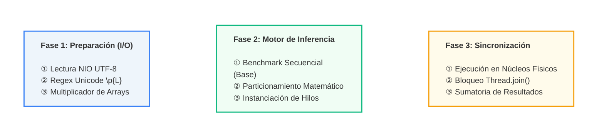

# Motor de Procesamiento Textual Multihilo (Java Threads)


## RESUMEN (ABSTRACT)

**Problema:** El análisis secuencial de grandes volúmenes de texto subutiliza los procesadores multinúcleo modernos, resultando en tiempos de ejecución lineales que se vuelven ineficientes al escalar la cantidad de datos.

**Propuesta:** Se implementa un motor de búsqueda y conteo de frecuencias léxicas en Java. El sistema evade herramientas de alto nivel como `ExecutorService` o `parallelStream` para gestionar la concurrencia a muy bajo nivel utilizando la clase nativa `Thread`, aislando la lectura de disco y dividiendo matemáticamente la carga de trabajo en memoria.

**Tecnologías:** Java (StandardCharsets, Regex Unicode), concurrencia nativa y automatización por `Makefile`.

**Resultados:** El sistema logró procesar más de **38 millones de palabras** en apenas **~85 milisegundos**, demostrando una aceleración de **3.63x** al paralelizar la carga en 4 hilos frente al enfoque lineal tradicional.

---

## ARQUITECTURA DEL SISTEMA

El proyecto está diseñado para garantizar la integridad de los datos evitando *Race Conditions* y separar estrictamente el tiempo de preparación del tiempo de CPU.



---

## Análisis de Rendimiento y Resultados

El experimento constó de dos fases: el procesamiento del texto original Don Quijote de la Mancha y una prueba de estrés utilizando una versión del texto ampliada 100 veces. Los tiempos reflejan el promedio de 5 iteraciones consecutivas.

### 1. Pruebas: Texto Original (386,793 palabras)

Se validó la integridad algorítmica asegurando que el conteo de la palabra exacta (`quijote`: 2245) y la secuencia (`ción`: 950) fuera matemáticamente idéntico en todos los métodos.

| Método de Procesamiento | Hilos | Tiempo Promedio (ms) | Aceleración (Speedup) |
|---|---|---|---|
| Secuencial (Baseline) | 1 | 4.8500 ms | 1.00x |
| Paralelo | 2 | 2.6681 ms | 1.82x |
| Paralelo | 4 | 1.4155 ms | 3.43x |

### 2. Pruebas: Texto Ampliado x100 (38,679,300 palabras)

En el escenario de carga masiva, la eficiencia del paralelismo absorbe por completo el overhead de la creación de hilos, demostrando una escalabilidad casi lineal.

| Método de Procesamiento | Hilos | Tiempo Promedio (ms) | Aceleración (Speedup) |
|---|---|---|---|
| Secuencial (Baseline) | 1 | 309.6917 ms | 1.00x |
| Paralelo | 2 | 164.0379 ms | 1.89x |
| Paralelo | 4 | 85.3444 ms | 3.63x |

---

## Compilación y Ejecución

El proyecto incluye un `Makefile` para abstraer la compilación manual de Java y la limpieza de binarios.

```bash
# 1. Clonar el repositorio
git clone https://github.com/elsebasdev1/secuential_and_parallel_processing
cd secuential_and_parallel_processing

# 2. Compilar el código y ejecutar las pruebas
make
```

---

## 📂 Estructura del Repositorio

```
├── resources/
│   └── quijote.txt         # Dataset de prueba (Obra completa en formato crudo)
├── src/
│   ├── App.java            # Orquestador de pruebas y lógica de particionamiento
│   └── ProcesadorHilo.java # Definición del Obrero (extends Thread)
└── Makefile                 # Automatización del proceso de compilación
```